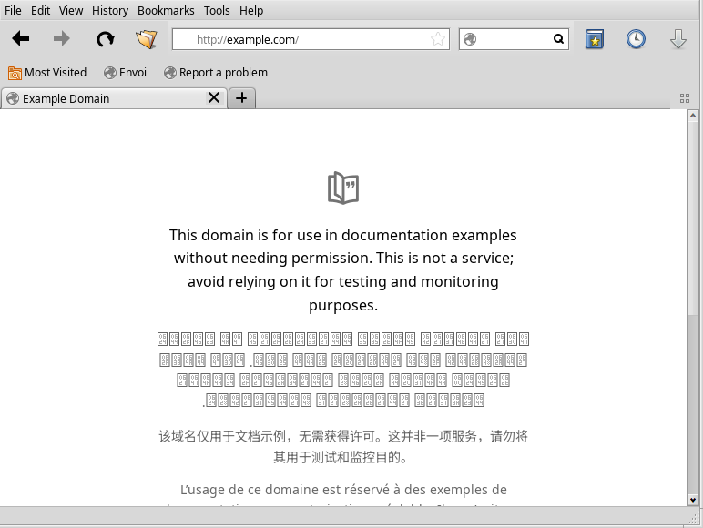

# Envoi

**Envoi** (the closing stanza that sends a poem on its way; also *envoy*, a messenger) is a web browser for
[Haiku](https://www.haiku-os.org/) and [Renku OS](https://github.com/RenkuOS/Source), with a
native Haiku user interface. It's an independent community project, built on the Unified XUL
Platform (UXP) with the Haiku engine work from [idumych/uxp-haiku](https://github.com/idumych/uxp-haiku)
(branch `haiku-envoi`), which is the `platform` submodule here.

Envoi is not endorsed by, or affiliated with, any other browser project. Please report problems
here, not to any upstream project.

**Status:** preview (0.2.0, adds WebRTC on x86_64). Packages for Haiku R1/beta6 x86_64 (which also installs on
Renku OS x86_64) and for Renku OS arm64. Expect rough edges: the release notes say what was
tested and what wasn't. See [PLAN-HAIKU.md](PLAN-HAIKU.md) for what's next.

## Install

Download the package for your system from [Releases](https://github.com/idumych/envoi/releases), then:

    pkgman install ./envoi-0.2.0-1-x86_64.hpkg     # Haiku R1/beta6, Renku OS x86_64
    pkgman install ./envoi-0.2.0-1-arm64.hpkg      # Renku OS arm64

Envoi appears in the Deskbar's Applications menu; the command is `envoi`.

## Building

- Haiku x86_64, in Haiku R1/beta6 with the HaikuPorts `_devel` packages listed in
  [haiku-app.env](haiku-app.env): `MOZCONFIG=$PWD/mozconfig-haiku ./mach build`, then
  `make -C ../obj package MOZ_DISABLE_PRECOMPILED_STARTUPCACHE=1` and
  `sh packaging/haiku/build-hpkg.sh ../obj . x86_64`.
- Renku OS arm64, cross-built on Linux: [packaging/haiku/arm64/README.md](packaging/haiku/arm64/README.md).

## Screenshots

Envoi on Haiku R1/beta6 (x86_64), loading an HTTPS site.

Envoi on Renku OS arm64 (in QEMU), loading a page.

## Licence

MPL 2.0 (see [LICENSE](LICENSE)); some bundled components carry other licences. Read
[TRADEMARK](TRADEMARK) for the trademark notice that comes with the source.
